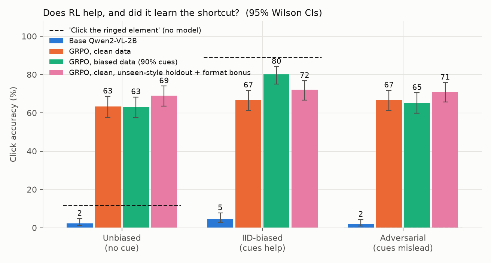
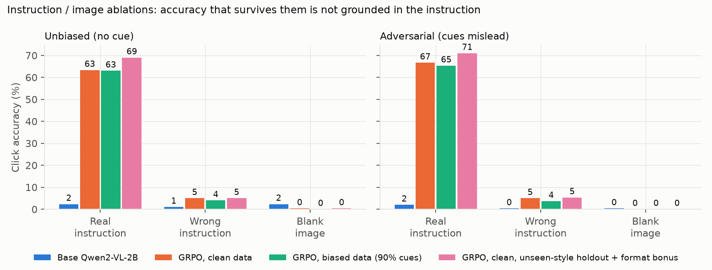
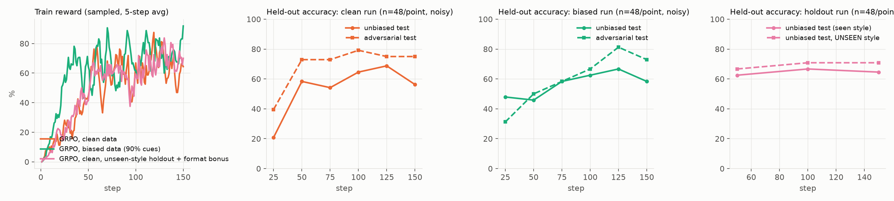

# ui_click_grpo

GRPO with a verifiable reward for UI clicking on a small vision-language model.

Train **Qwen2-VL-2B-Instruct** (LoRA, hand-written GRPO trainer) to click the element named by an instruction. The reward is
**1 if the click lands inside the target box, else 0**. The project measures two things: whether the model improves, and
whether it learns shortcuts (cues unrelated to the instruction) instead of reading it.

Everything ran on one 8 GB laptop GPU (RTX 5050). One training seed per run.

## Findings

| # | Claim | Evidence | Confidence |
|---|---|---|---|
| 1 | RL with a binary click reward takes the base model from **2% to 63%** on held-out synthetic UIs in 150 steps (about 50 min). | Table 1, n = 300 | High for this distribution |
| 2 | The gain needs the instruction and the screenshot: with a wrong instruction accuracy is 4-5%, with a blank image 0%. The final policies show none of the failure patterns I checked for (answer spam, click collapse onto one spot, invalid format). | Table 2 | High |
| 3 | When a spurious cue (a blue "focus ring") predicts the target 90% of the time in training, the policy **does learn to use it**: +14.7 pts when the ring marks the target, but it is *not* fooled when the ring mislabels (decoy clicks <= 3.6%). The model trained without the cue shows no cue effect. | Table 3 | Medium: one seed, CIs of ~+-5 |
| 4 | A *position* cue (target in left half) was **not** picked up. | Table 3 | Medium |
| 5 | Gains carry over to a colour theme and font never seen in training (69.3% seen vs 69.7% unseen). | Table 4 | Medium |
| 6 | Zero-shot on **real UIs (ScreenSpot)**: 8.5% -> **53%** (clean) / 46% (cue-trained). The cue-trained model transfers worse; the CIs overlap slightly, so treat this as suggestive. | Table 5 | Medium |
| 7 | It is **not** only learning large elements: accuracy rises at every size, but large targets stay easier. | Tables 1, 5 | High |
| 8 | Real failures remain: checkboxes (~8%), tabs (40-50%), icons (~50%). | Table 6 | High |

**Control: is the real-UI gain just a better prompt?** I also prompted the *base* model for its native bounding box and clicked
the box centre (`--mode box`). It scored **9.8%** [7.2, 13.1] on the same 400 ScreenSpot samples, against 53.2% for the
RL-trained model. Caveat: the 24-token output cap truncated many of its chatty answers, so only 60.8% were parseable; among
the parseable ones it was right 16% of the time (clean RL model: 54%). So re-prompting alone does not recover the gain, but this
control was handicapped by the cap and a better prompt could close some of the gap.

## Extension: serving the trained policy (`serving/`)

The `serving/` folder serves the merged LoRA policy and measures what each serving technique buys, with raw logs and a click-accuracy
check after every change. Tables, setup, dead ends and caveats are in [serving/README.md](serving/README.md); nothing there changes the
training code or the results above.

* **The merged checkpoint was verified** against the adapter model under pass criteria fixed in advance: 63.33% vs 63.33% (synthetic,
  n = 300) and 53.25% vs 53.75% (ScreenSpot subset, n = 400).
* **vLLM vs SGLang** on one RTX 5050 laptop GPU (8 GB, Blackwell) under WSL2: 69 load-test runs, 3 repeats per cell, 0 request errors,
  and click accuracy within 1 point of the reference in all six engine configurations.
* **Prefix caching** roughly doubled vLLM's throughput (1.95-2.41x across concurrency levels); for SGLang it helped only at low concurrency.
* **vLLM reached about 2.5-3x SGLang's throughput at 16 concurrent clients** (3.52 vs 1.40 req/s in the same session; 3.52 vs 1.15 against
  SGLang's FlashInfer follow-up, a later session). SGLang with FlashInfer attention and larger CUDA graphs did not close the gap.
  Caveats: the engines are not identically configured, it is one GPU, a rerun of one vLLM cell came out 13% lower than the first
  measurement, and the GPU's power state was not controlled, so this is not a general claim about the engines.
* **A prefix-aware request router in Rust** (consistent hashing with bounded load, health checks, retries, circuit breaker, Prometheus
  metrics; 42 tests) in front of two FP8 vLLM replicas on the same GPU. It routes as designed and raised the share of prompt tokens
  served from the prefix cache (65% vs 51% at 16 clients) and throughput (5.01 vs 3.77 req/s at 16 clients), but median time to first
  token was not better, and at 32 clients it was worse. Run order moved latency by up to 2x in the first comparison, so the final one
  alternates policy order. Killing a replica under load lost 1 of 560 requests; the router noticed in 0.9 s and was routing to the
  restarted replica 1.2 s after it was ready. The FP8 replicas cost 3.25 points on ScreenSpot against bf16 (p=0.041); the router itself
  did not change clicks.
* **A fused RMSNorm + INT8 quantisation kernel in Triton**, registered as a `torch.library` custom op (48 GPU tests including `opcheck`).
  It is a standalone operator, not integrated into an engine, so there is no end-to-end claim. Against same-math PyTorch eager it is
  11.8-38.0x faster across 36 size/dtype cells, and 0.90-2.56x against `torch.compile` (tied at the smallest cells). In the DRAM-bound
  cells its best repeat reaches 316-326 GB/s, 82-85% of the reported 384 GB/s peak and about the measured copy bandwidth; medians are
  lower because the laptop GPU was power-capped and thermally throttled. Quantising every RMSNorm output of the merged model to INT8
  changed click accuracy by +0.7 points (synthetic) and -1.5 points (ScreenSpot), within this evaluation's noise: no change detected,
  which small sets cannot rule out.
* **Planned, not started:** prefill/decode disaggregation and TensorRT-LLM.

## Setup

* **Task.** Given a screenshot and an instruction ("Click the *Save* button.") answer `(x, y)` in 0-1000 normalised image
  coordinates. A click is a hit if it is inside the ground-truth box (`x0,y0,x1,y1`, same units).
* **Reward** (`uiclick/reward.py`): `1[hit]`, and exactly 0 for anything unparseable. The parser accepts exactly one
  `(x, y)` pair and *no other number*, so spraying several points, answering with a box, or a box truncated at the token
  limit all score 0. (The truncated-box hole was real: my first parser accepted `(733, 414, 886,` as the click
  `(733, 414)`. See `NOTES.md`.) An optional small format bonus exists (`--format_bonus`); only the `holdout` run used it (0.1).
* **Data** (`uiclick/synth.py`). Procedurally rendered UIs (buttons, links, checkboxes, inputs, tabs, icons; 4 colour themes,
  5 fonts, 6-13 elements per screen) with exact boxes. Every sample is a pure function of its seed, so train
  (seeds < 1e6) and test (seeds >= 1e7) are disjoint and fresh samples are drawn every step. Labels are unique per
  screen so the instruction identifies one element.
* **Planted shortcuts** (what makes "did it learn a shortcut?" measurable). Two cues carry no information about the
  instruction: the *focus ring* (a blue outline) and the *position* (target in the left half). `p_ring` / `p_pos` set how often
  they coincide with the target. `clean` training: independent (no shortcut available). `biased`: 90% / 90%.
* **Trainer** (`uiclick/grpo.py`, ~150 lines). Per step: 4 fresh screenshots x 8 sampled answers, group-normalised
  advantages, plain on-policy policy gradient (the PPO ratio is 1, so clipping is moot), LoRA r = 16 on the language
  model, lr 5e-5, no KL. Groups where all 8 answers score the same carry no gradient and are skipped (rate logged).
  The prompt (image + text) is processed once and its KV cache is shared by the 8 answers: exact gradients, ~3x faster
  than the naive loop. Checked against a plain full forward pass: mean |dlogp| = 0.02 (bf16 rounding).
* **Runs.** `clean` (cues independent), `biased` (cues 90%), `holdout` (clean cues, trained only on 3 of 4 themes and 4 of 5
  fonts, + 0.1 format bonus). `holdout` differs from `clean` in two ways, so it is not a clean ablation of either.

## Results

All accuracies are greedy decoding, 95% Wilson intervals, n = 300 per cell unless stated. Full tables:
[results/results.md](results/results.md).



**Table 1. Accuracy on held-out synthetic screens.** *Unbiased*: cues independent of target. *IID-biased*: cues point at the
target 90%. *Adversarial*: both cues point away.

| model | unbiased | IID-biased | adversarial | gap (IID - adv) |
|---|---|---|---|---|
| base Qwen2-VL-2B | 2.3% | 4.7% | 2.0% | +2.7 |
| GRPO, clean data | 63.3% [57.7, 68.6] | 66.7% | 66.7% | +0.0 |
| GRPO, biased data | 63.0% [57.4, 68.3] | **80.0%** [75.1, 84.1] | 65.3% [59.8, 70.5] | **+14.7** |
| *no-model: random click* | 0.8% | 0.2% | 0.8% | |
| *no-model: always click centre* | 1.6% | 0.4% | 1.4% | |
| *no-model: click a random element* | 9.4% | 8.0% | 8.2% | |
| *no-model: always click the ringed element* | 11.6% | 89.0% | 0.0% | |

Reading it: the clean model has no gap. The biased model matches it when the cue is uninformative (63%) but gets +13 pts
over it when the ring points at the target. The last baseline row shows the shortcut is worth 89% on IID-biased data if
followed blindly, so the model uses it only as a hint, not as a rule.

**Table 2. Ablations** (accuracy against the original target box; `unbiased` split).

| model | real instruction | wrong instruction | blank image |
|---|---|---|---|
| base | 2.3% | 1.0% | 2.3% |
| clean | 63.3% | 5.0% | 0.3% |
| biased | 63.0% | 4.0% | 0.0% |

The policies need both inputs. Clicks are not collapsed onto one spot (most common click = 0.7-1.0% of answers), format
validity is 100%, and in the adversarial split the ringed decoy gets 0.3-0.7% of clicks.



**Table 3. Which cue? (2 x 2 isolation, 300 per cell).** One cue is aligned or anti-aligned with the target, the other is independent.

| model | position aligned / anti | effect | ring aligned / anti | effect |
|---|---|---|---|---|
| clean | 63.7% / 67.3% | -3.7 | 64.0% / 68.3% | -4.3 |
| biased | 58.0% / 67.3% | -9.3 | **78.3% / 63.7%** | **+14.7** |

The shortcut is the **ring**. The position cue gives no benefit (the negative values are within noise and also appear
for the clean model; left-half targets are slightly harder in this generator). With a misleading ring the biased model is
~4.6 pts below the clean one (63.7% vs 68.3%), and on tab targets it clicks another element more often (38% vs 17%, Table 6).

**Table 4. Unseen visual style** (a colour theme + font never seen in training; `holdout` run).

| model | seen style, unbiased | UNSEEN style, unbiased | seen, adversarial | UNSEEN, adversarial |
|---|---|---|---|---|
| base | 2.3% | 2.7% | 2.0% | 4.0% |
| holdout | 69.3% [63.9, 74.3] | 69.7% [64.2, 74.6] | 71.7% | 75.3% |

**Table 5. Real UIs: ScreenSpot** (never trained on; random 400-sample subset, seed 0; same prompt; zero-shot). Convention
check: clicking the exact centre of the converted ground-truth box scores **100.0%** on all 1,272 samples.

| model | accuracy | valid format | text | icon | small | medium | large |
|---|---|---|---|---|---|---|---|
| base | 8.5% [6.1, 11.6] | 86.5% | 10.1% | 6.7% | 5.2% | 9.0% | 11.3% |
| base, prompted for a box (control) | 9.8% [7.2, 13.1] | 60.8% | 10.1% | 9.3% | 5.2% | 11.3% | 12.8% |
| GRPO clean | **53.2%** [48.4, 58.1] | 98.0% | 67.1% | 38.3% | 42.5% | 42.9% | 74.4% |
| GRPO biased | 46.2% [41.4, 51.1] | 100% | 60.9% | 30.6% | 30.6% | 39.1% | 69.2% |
| GRPO holdout | 57.2% [52.4, 62.0] | 100% | 71.5% | 42.0% | 44.0% | 48.1% | 79.7% |
| *always click centre* | 2.5% | | 3.4% | 1.6% | 0.0% | 0.0% | 7.5% |

The base model is not failing on format: it gives a valid point 86.5% of the time and is right in 9.8% of those.
Its answers are often prior-like (`(100, 100)`, `(1000, 100)`). Prompting the base model for a box instead (control above) gives 9.8%, so the gain is not just an output-format or
prompting effect, though I did not tune that prompt or lift the token cap.

**Table 6. Where do misses go?** (1,200 predictions over the cue-isolation splits, per target type; see
[results/failures.md](results/failures.md).) *target_extent*: click on the target's own label; *other_element*: click on a
different element; *near*: within 30 px of the box.

| target type | clean: hit / extent / other / near / far | biased: hit / extent / other / near / far |
|---|---|---|
| button | 89 / 0 / 1 / 9 / 1 | 92 / 0 / 1 / 5 / 1 |
| checkbox | **7** / 37 / 4 / 35 / 16 | **9** / 42 / 14 / 18 / 17 |
| icon | 54 / 0 / 7 / 35 / 4 | 46 / 0 / 13 / 35 / 7 |
| input | 88 / 3 / 1 / 8 / 1 | 92 / 0 / 1 / 5 / 1 |
| link | 71 / 0 / 0 / 29 / 1 | 86 / 0 / 1 / 14 / 0 |
| tab | 50 / 0 / 17 / 30 / 3 | 40 / 0 / 38 / 3 / 19 |

Most misses are localisation errors (*near*), not instruction errors. Checkboxes fail because the model clicks the label
text next to the 20 px box (37-42% of the time) or just beside it. The check is by eye as well:
`results/convention_synth_clean.png` draws the click (red) against the box (green); `eval_screenspot.py --draw K` produces the
same overlays on real screenshots (not committed, since they are third-party screenshots).



## What didn't work / limitations

* **Single seed per run.** Intervals are evaluation sampling error only. Differences under ~5 pts between runs
  (e.g. clean 63.3 vs biased 63.0, or the 53 vs 46 on ScreenSpot) should not be over-read.
* **Synthetic, templated task.** 63-70% is in-distribution. Real-UI transfer is measured only by ScreenSpot with a
  400-sample subset (+-5 pts). I did not test other benchmarks, longer instructions, or non-English UIs.
* **Training plateaus.** By the last 10 steps only 5-17% of groups carry gradient (the rest are all-hit or all-miss). I did
  not sweep learning rate, group size or steps, and did not try a KL term (`--beta` exists, untested), so I can't say whether
  more training would help or when hacking would appear.
* **The format bonus has no clean ablation.** It was only used in the run that also restricts styles.
* **Checkbox targets are essentially unsolved (~8%)**; tab and icon targets are mediocre. The cue-trained model confuses
  tabs with neighbouring elements 38% of the time.
* **Early dead ends** (details in [NOTES.md](NOTES.md)): a naive generate-then-reforward loop took 20-60 s/step; fp32 LoRA
  activations spilled the 8 GB card; running eval inside the training process was ~100x slower until I freed the allocator
  (it cost the first run ~70 of its 109 minutes; its wall-clock in the tables is inflated by that); an eval was lost to the
  laptop sleeping mid-run and had to be rerun.
* The synthetic generator is skewed in ways I did not plant (targets are 55% left-half, mean y = 0.40), which is why a
  "mean train target" baseline is included.

## Reproduce

The trained LoRA adapters (~71 MB each) are not in the repo; the training commands below regenerate them (about 50 min
each on an RTX 5050). Evaluation numbers in `results/` were produced from those adapters.

```bash
python -m venv .venv && source .venv/bin/activate        # Windows: .venv\Scripts\activate
pip install torch --index-url https://download.pytorch.org/whl/cu128   # Blackwell GPUs need cu128 or newer
pip install -r requirements.txt
pytest tests                                                          # reward parser + generator
python scripts/train.py --train_split clean  --out runs/clean  --steps 150
python scripts/train.py --train_split biased --out runs/biased --steps 150
python scripts/train.py --train_split clean --train_style seen --format_bonus 0.1 --out runs/holdout --steps 150 --eval_every 50
python scripts/eval.py --name base                                    # also: --adapter runs/clean/adapter --name clean ...
python scripts/eval.py --name clean_cue --adapter runs/clean/adapter --cue_eval --style_only
python scripts/eval_screenspot.py --name clean --adapter runs/clean/adapter --n 400 --draw 6
python scripts/analyze_failures.py clean_cue biased_cue && python scripts/report.py
```

Each training run writes `runs/<name>/run_config.json` (args, seed range, model id, reward definition, library versions) and
`train_log.jsonl`; each eval json embeds the same metadata. Tested with torch 2.11+cu128, transformers 5.20, peft 0.21.
Synthetic images depend on the installed fonts (Windows fonts here), so pixel-exact reproduction needs the same fonts;
ScreenSpot results do not.

## Layout

```
uiclick/synth.py      UI generator + planted cues + held-out styles      uiclick/reward.py     verifiable reward + parser
uiclick/grpo.py       GRPO trainer (shared-prompt KV cache)              uiclick/evaluate.py   scoring, probes, baselines
scripts/              train / eval / eval_screenspot / analyze_failures / check_convention / report
results/              eval jsons, figures, results.md, failures.md       NOTES.md              dead ends and fixes
serving/              extension: merged checkpoint, traces, load client, vLLM vs SGLang benchmark (see serving/README.md)
```
